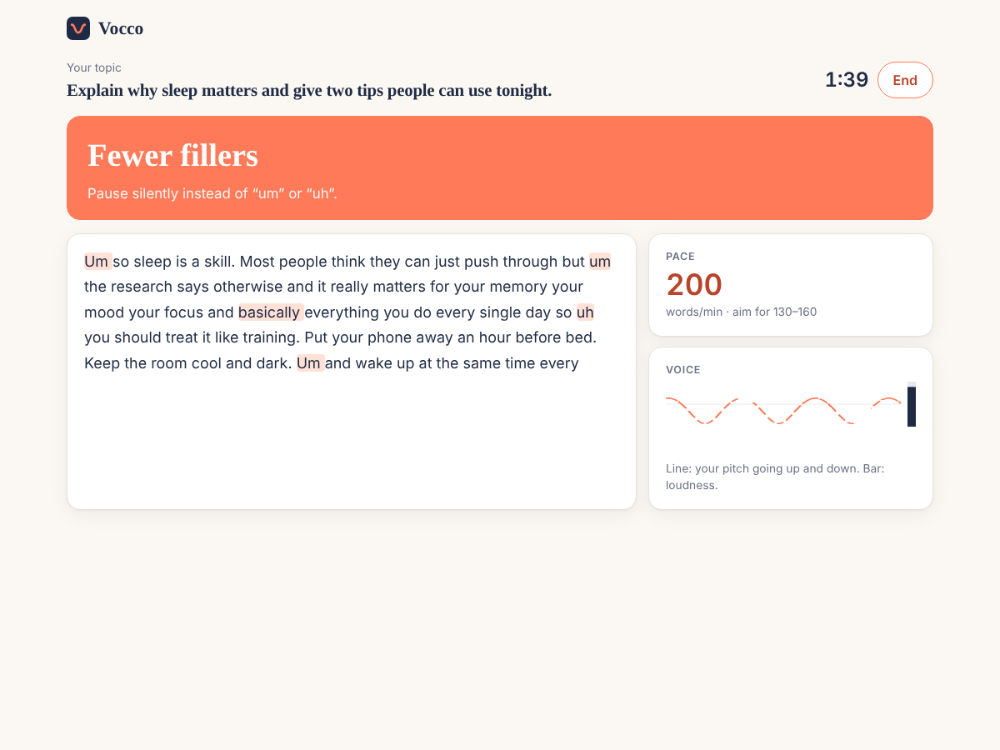
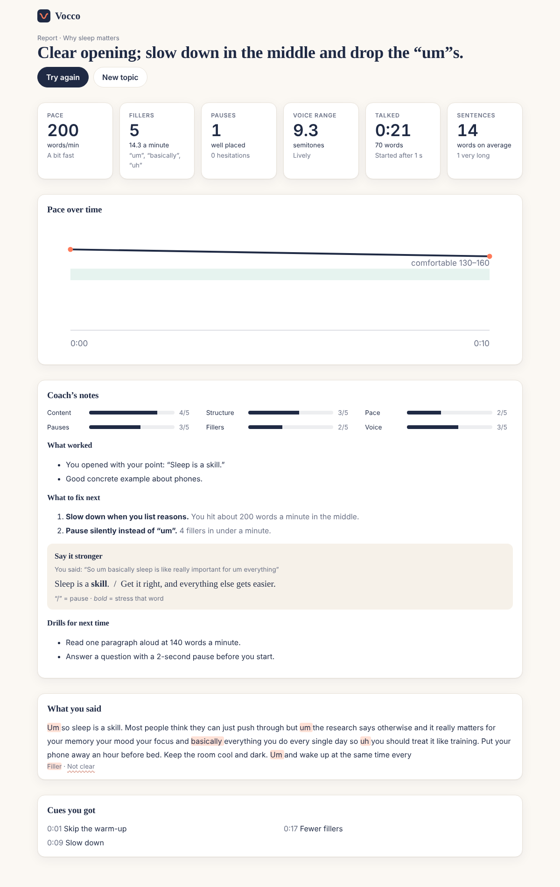

# Vocco

**Practice out loud. Get coached while you speak.**

Pick a topic and talk. Vocco listens and tells you, live, when to start, pause, slow down, lift your voice and land
your sentences. When you finish, you get a report: pace over time, fillers, pauses, voice range, scores, what to fix,
a stronger version of your weakest part, and drills for next time.

## What's in v0.1

- **Talk on a topic** — 54 topics in 7 categories (everyday, work, interviews, pitches, speeches, debate motions, explain it), "Surprise me", or your own topic.
- **Setup** — length (1–5 min), time to think first, which skills to coach live (pace, pauses, fillers, voice), language, mic, and a 6-second mic check that learns your normal volume and pitch.
- **Live session** — one cue at a time (*Start now, Skip the warm-up, Slow down, A bit faster, Pause, Hold the pause, Fewer fillers, Lift your voice, Louder, Don't trail off, Land it down*), live transcript with fillers and unclear words marked, pace meter, pitch line and loudness bar.
- **Report** — measured numbers plus the coach's notes (scores, what worked, what to fix, *say it stronger*, drills), transcript, and the cues you got.
- **History** in your browser. Nothing about a session is stored on the server.

Coming next (see [docs/PLAN.md](docs/PLAN.md)): accounts and credits, pronunciation scoring, a debate opponent that talks back, audience Q&A, drills.

## Run it

Requires Node 22+.

```bash
npm install
cp apps/server/.env.example apps/server/.env   # add DEEPGRAM_API_KEY and ANTHROPIC_API_KEY
npm run dev                                     # server :8787 + web http://localhost:5173
```

Use Chrome or Edge, allow the microphone, and wear headphones if you'll play anything out loud.

Production: `npm run build && npm start` — one Node process serves the app, the API and the `/session` WebSocket.

## Test

```bash
npm test           # shared coaching core + server (no network)
npm run typecheck  # web app
```

## Layout

```
packages/shared   coaching engine, pitch & loudness, fillers, topics (plain JS, used by both sides)
apps/server       Node: /session relay to Deepgram, /api/report via Claude, serves the web app
apps/web          React + Vite + TypeScript
docs/             PLAN.md (living plan & milestones), DECISIONS.md (why things are the way they are),
                  product-plan.md (the original product plan)
```

## Screens

| Live session | Report |
|---|---|
|  |  |

(Captured in Chromium with a synthetic voice and a simulated server.)
